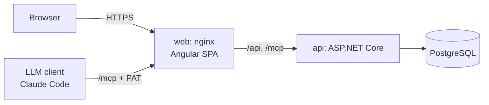

# Architecture overview

## Runtime topology



* **web** — nginx serving the compiled Angular app and reverse-proxying `/api`, `/mcp`, `/scalar` and `/health` to the API. It is the only published port in production (D-73). The SPA and API are same-origin, so the session cookie never crosses origins.
* **api** — a single ASP.NET Core process hosting the REST API, the MCP server (`/mcp`) and background jobs.
* **db** — PostgreSQL. The only stateful component.

## Solution layout

```
src/
  Ticketing.Domain/          entities, value objects, enums, domain rules (no dependencies)
  Ticketing.Application/     use cases (commands / queries), DTOs, validation, abstractions
  Ticketing.Infrastructure/  EF Core DbContext + configurations + migrations, auth, hashing, feature flag store
  Ticketing.Api/             host: minimal API endpoints, MCP tools, auth wiring, OpenAPI
web/                         Angular SPA
tests/
  Ticketing.Domain.Tests/        fast unit tests
  Ticketing.IntegrationTests/    WebApplicationFactory + Testcontainers PostgreSQL
e2e/                         Playwright (TypeScript) against docker compose
docs/                        glossary, ADRs, workflows, decisions, ideas, design
```

## Backend conventions

* **One use case = one handler class** in `Application/<Feature>/` (e.g. `Tickets/CreateTicket.cs` containing the request record, validator and handler). Handlers are plain classes registered in DI by assembly scanning; no mediator library.
* **The REST endpoint and the MCP tool call the same handler.** Neither contains business logic — they translate transport ↔ handler only. This is what keeps the MCP server and the UI behaviourally identical.
* **Authorization lives in the application layer** (`IProjectAccess` / `ICurrentUser`), not only in endpoint attributes, so MCP tools get identical permission checks.
* **Errors** are returned as RFC 9457 problem details with a stable `code` — see [api-conventions.md](api-conventions.md).
* **Endpoints** are grouped per feature in `Api/Endpoints/<Feature>Endpoints.cs` via a `Map<Feature>Endpoints(this IEndpointRouteBuilder)` extension, so features never edit a shared file beyond one registration line.
* **EF Core** configurations live one-per-entity in `Infrastructure/Persistence/Configurations`, applied with `ApplyConfigurationsFromAssembly`. Reads use `AsNoTracking` projections straight into DTOs.
* **IDs** are `Guid` (v7, time-ordered) except where a human-facing number exists (ticket number).

## Frontend conventions

* Standalone components, zoneless change detection, signals everywhere, `OnPush` semantics.
* `src/app/core` — auth, HTTP interceptors, API clients, feature flags, view-variant registry, layout shell.
* `src/app/shared` — reusable presentational components (badges, avatars, markdown, chips).
* `src/app/features/<feature>` — lazily loaded route trees; each feature owns its `*.routes.ts`.
* Each routed page is split into a **store** (signal-based state + API calls) and a **view** (presentational). See ADR on A/B-ready views.

## Security notes

* [agent-delegation-threats.md](agent-delegation-threats.md) — threat model for Delegate to agent (deep links, prompt injection, templates, PATs, local folders), with the control and test for each threat.
