# Domain workflows

The key workflows of Ticketing as state and sequence diagrams. The [refined spec](../product/01-refined-spec.md) is normative; this document illustrates it and links each workflow to its section. Terms are defined in the [glossary](../glossary.md). Technical mechanics are in the [ADRs](../adr/README.md).

Every write described below runs inside one application handler, in one database transaction, and records activity entries with the caller's write channel (`Web`, `Api` or `Mcp`) ([ADR 0002](../adr/0002-modular-monolith-and-layering.md)). The diagrams leave out the generic steps (authentication, effective-access check, validation, `If-Match` concurrency check) unless they matter to the flow.

## Contents

1. [Ticket lifecycle and status side effects](#1-ticket-lifecycle-and-status-side-effects)
2. [Parent and child rules](#2-parent-and-child-rules)
3. [Backlog and board moves](#3-backlog-and-board-moves)
4. [Test case lifecycle](#4-test-case-lifecycle)
5. [Regression session lifecycle](#5-regression-session-lifecycle)
6. [PAT lifecycle and authentication](#6-pat-lifecycle-and-authentication)
7. [User onboarding](#7-user-onboarding)
8. [Feature flag evaluation and view variants](#8-feature-flag-evaluation-and-view-variants)
9. [MCP request flow](#9-mcp-request-flow)
10. [Attachment upload](#10-attachment-upload)

## 1. Ticket lifecycle and status side effects

Spec: [§6.2](../product/01-refined-spec.md#62-ticket-lifecycle), D-05, D-33.

Status transitions are free: any status may move to any other. The diagram groups the statuses by status category; the arrows between categories are the ones with side effects.

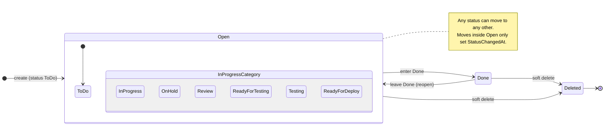

What a status change does:

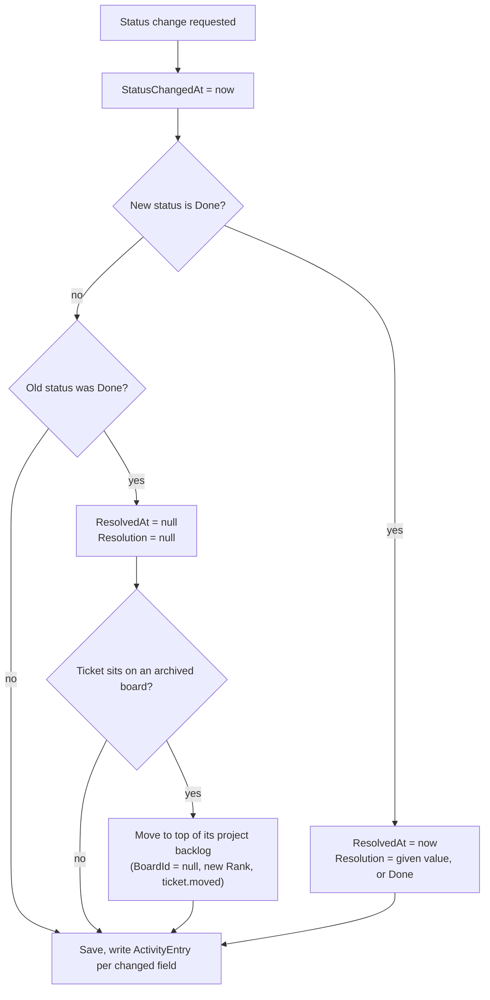

- A `Resolution` sent with a status other than `Done` is a validation error: resolution is set if and only if the status is `Done`.
- Moving a ticket to a specific board column changes its status as part of the move ([section 3](#3-backlog-and-board-moves)); the same side effects apply.
- One PATCH that changes several fields writes one `ticket.field.changed` entry per changed field, all with the same `OccurredAt`. Fields sent with their current value write nothing and do not bump `UpdatedAt`. A reopened ticket that leaves an archived board writes `ticket.moved` (field `boardId`).
- Opening a deleted ticket answers 404 `ticket.deleted` with "WEB-42 was deleted by X on date" (D-49).

Deleting a ticket (Owner only):

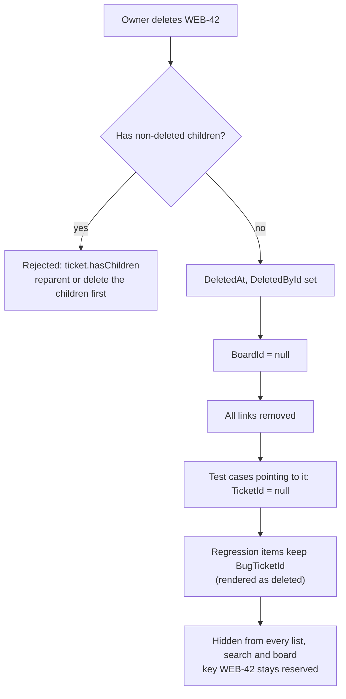

## 2. Parent and child rules

Spec: [§6.3](../product/01-refined-spec.md#63-parent-and-child), D-06.

The same checks run when a parent is set (create or update) and when a ticket's type changes. Depth counts levels, so Epic > UserStory > Technical is depth 3, the maximum.

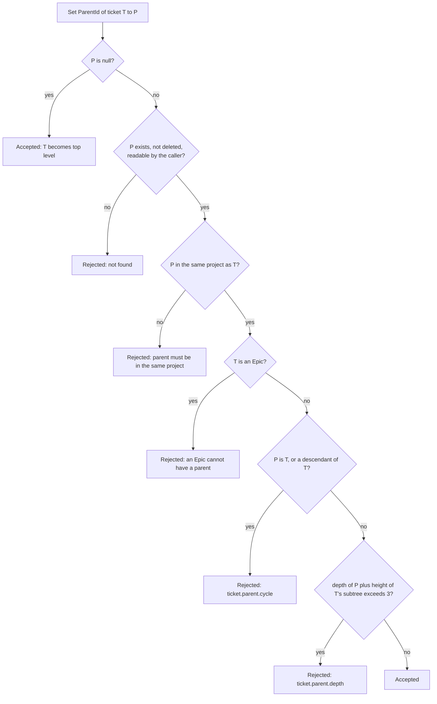

Type changes:

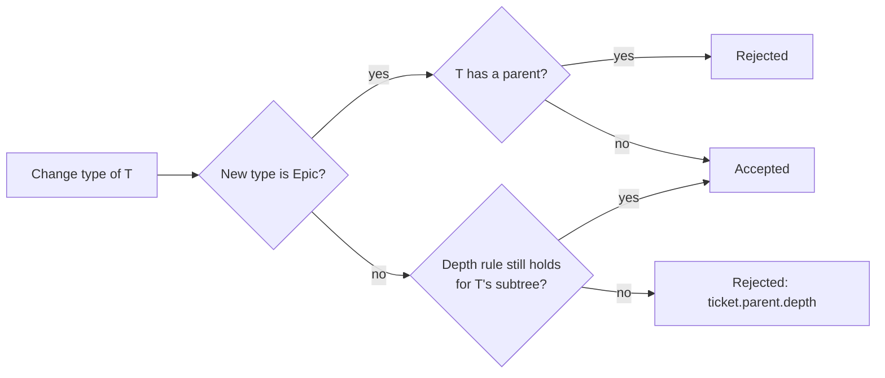

- Children are independent of their parent: status, board and backlog placement never roll up or cascade.
- The ticket view lists direct children with a progress bar by status category.

## 3. Backlog and board moves

Spec: [§6.4](../product/01-refined-spec.md#64-backlog-and-boards), [§6.6](../product/01-refined-spec.md#66-ranking), D-09, D-30. Ranking mechanics: [ADR 0010](../adr/0010-fractional-index-ranking.md).

A ticket is always in exactly one container: its project backlog or one board.

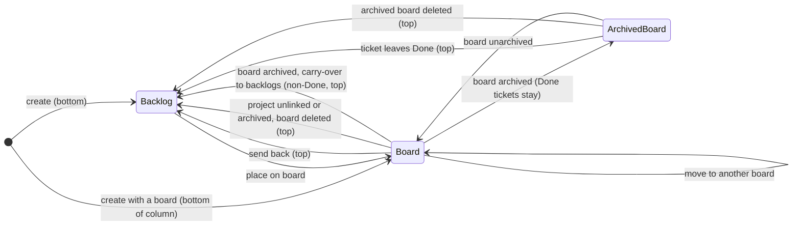

Default positions:

| Event | Position |
| --- | --- |
| New ticket in the backlog | Bottom of the backlog |
| Ticket sent back to the backlog (by a user or by a cascade) | Top of the backlog; several tickets keep their relative order |
| Ticket placed on a board without a position | Bottom of its status column |
| Ticket dropped between two cards | Between them |

A move, including a multi-select move:

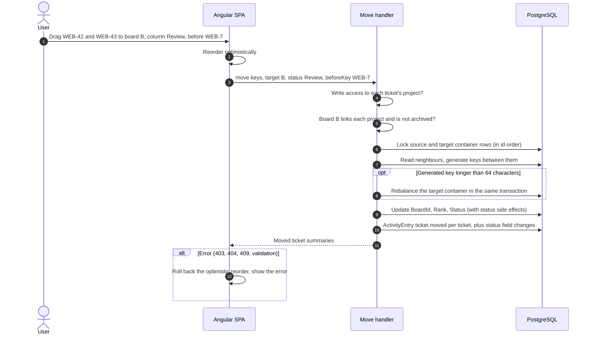

- Status changes on a move only when the move targets a specific column.
- Reordering inside the backlog (D-48) moves the selected tickets as one block, in the order sent, right before or after another backlog ticket or to the top or bottom. The neighbours are read under the container lock, and the block gets consecutive ranks; a too-long key rebalances the backlog with free slots. Rank changes write no history.
- Placing on a board requires: the board links the ticket's project, the board is not archived, and the actor can write to the project.

Board archive with carry-over:

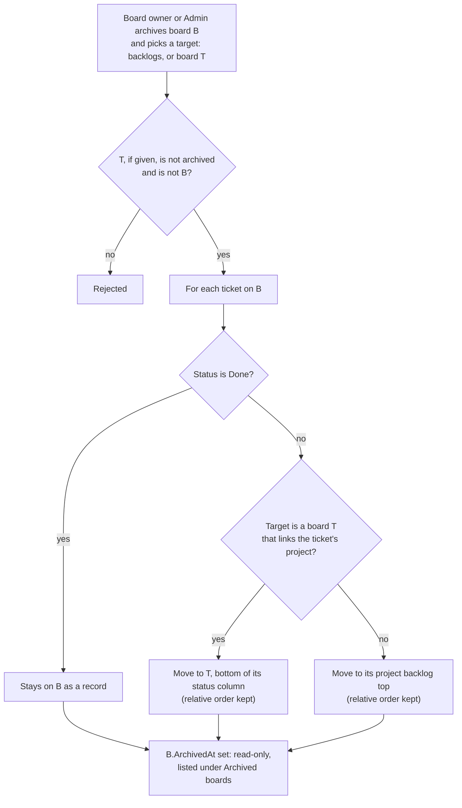

Other cascades:

- **Unlink a project from a board:** that project's tickets on the board go to the backlog top, keeping relative order. The UI confirms with the count.
- **Archive a project:** all its tickets leave all boards, archived boards included, and the project is unlinked from every board. The tickets go to the backlog top as one block, ordered board by board (oldest board first) and by board rank within a board (D-52). Each moved ticket gets a `ticket.moved` entry (`boardId` old → null) and each board a `board.project.unlinked` entry. Unarchiving does not relink boards.
- **Unarchive a project:** if no active Owner member is left (owners deactivated while it was archived), the acting Admin becomes an Owner (D-52).
- **Delete a project:** Admin only, archived only, web session only, confirmed by typing the key. Soft delete: the key stays reserved, the name becomes free (D-53).
- **Delete a board:** all its tickets, Done included, go to their backlogs (top); the board is soft-deleted.
- **Project becomes private:** its tickets stay on boards and simply disappear for users who lose access ([§6.5](../product/01-refined-spec.md#65-private-projects-on-shared-boards)).

Spec gap: board archive, unlink and delete move tickets of projects the acting board owner may not be able to read or write. The spec treats these as board actions, so the cascade does not check per-ticket write access. Confirm with the product owner.

## 4. Test case lifecycle

Spec: [§6.10](../product/01-refined-spec.md#610-test-case-lifecycle), [§4.9](../product/01-refined-spec.md#49-testcase), D-19, D-21.

Status and archive are independent: an archived case keeps its status.

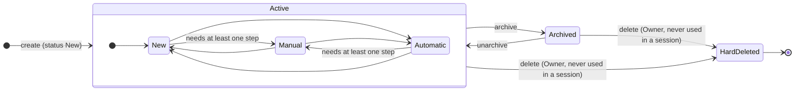

| Status | Meaning | In a new regression session |
| --- | --- | --- |
| `New` | Not ready | Excluded |
| `Manual` | Executed by a person; at least one step | Item `WaitingForExecution` |
| `Automatic` | Covered by an automated test (`AutomationReference`) | Item `Passed` (auto-passed) |
| any, archived | Hidden by default | Excluded |

Editing a test case never changes running or completed sessions: they hold snapshots. A case that has appeared in a session can only be archived, not deleted.

## 5. Regression session lifecycle

Spec: [§6.11](../product/01-refined-spec.md#611-regression-session-lifecycle), [§4.10](../product/01-refined-spec.md#410-regressionsession), [§4.11](../product/01-refined-spec.md#411-regressionsessionitem), D-13, D-20 to D-25.

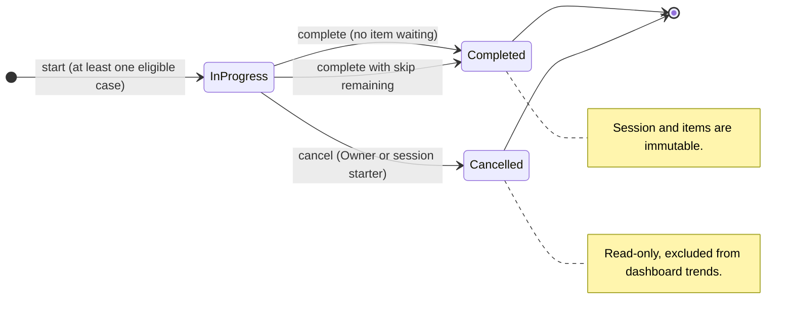

Items, while the session is `InProgress`:

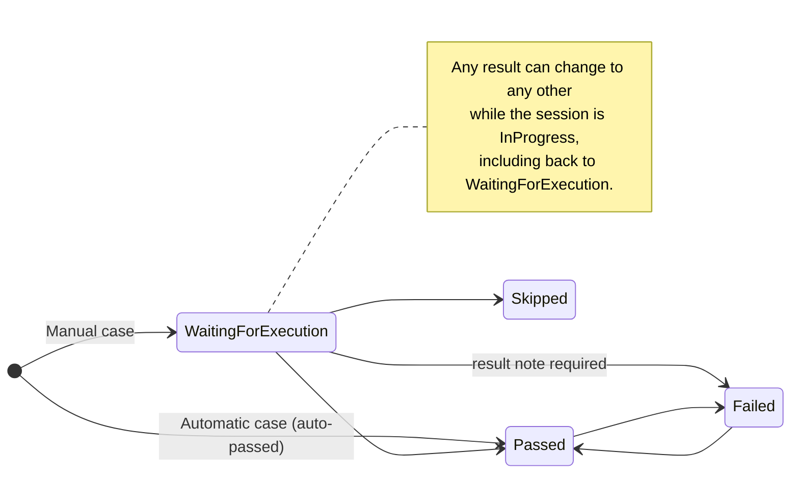

Starting a session:

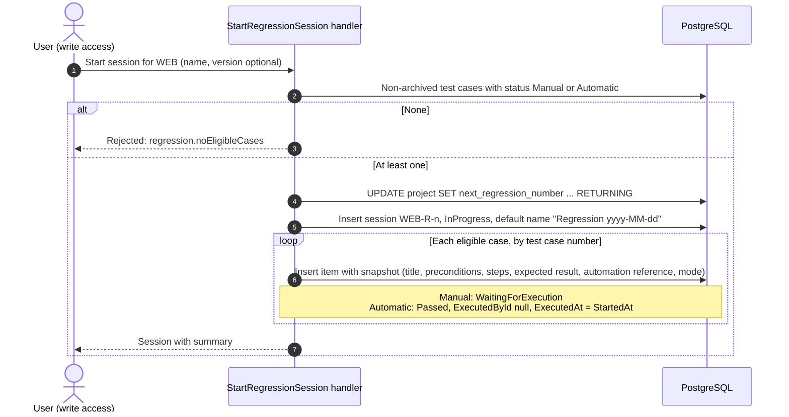

Executing items and creating a bug from a failure:

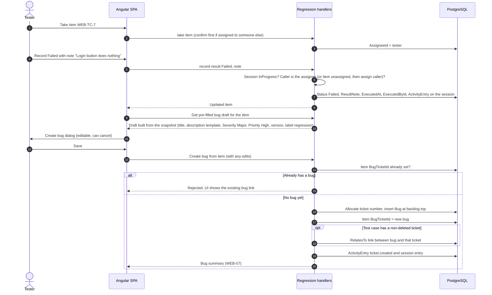

- The bug description follows the template in [§6.11](../product/01-refined-spec.md#611-regression-session-lifecycle). The server builds the draft, so the UI dialog, REST and MCP (`record_regression_result` with `createBug: true`, which records the result and creates the bug in one call) produce identical bugs.
- Owners can assign or unassign items for others; only the assignee records results.
- Bugs are created only while the session is `InProgress`. With `createBug`, the result and the bug are saved together or not at all (D-70).
- Item writes share-lock the session row; complete and cancel lock it exclusively, so no result lands on a completed session (D-71).

Completing a session:

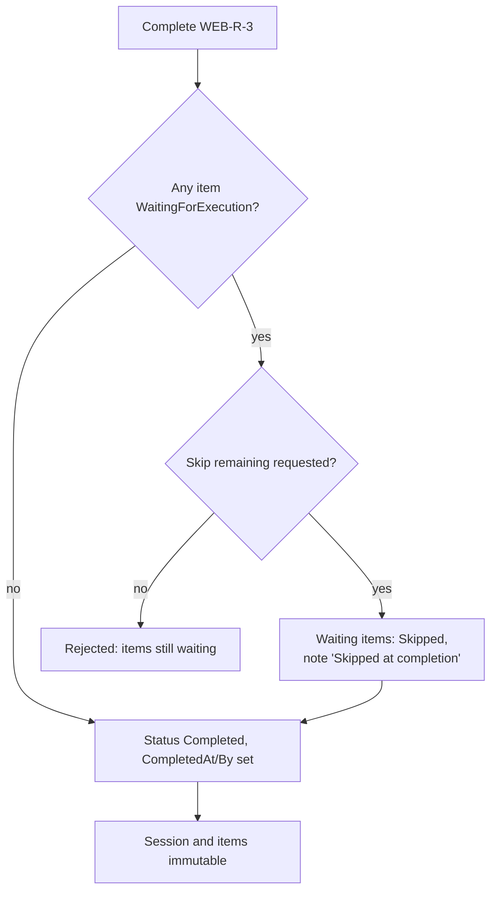

Session summary: total, passed (manual and auto split), failed, skipped, waiting, pass rate = passed / (passed + failed), bugs created.

## 6. PAT lifecycle and authentication

Spec: [§4.2](../product/01-refined-spec.md#42-personalaccesstoken), [§5.5](../product/01-refined-spec.md#55-pat-scope), [§6.12](../product/01-refined-spec.md#612-pat-lifecycle), D-37. Mechanics: [ADR 0003](../adr/0003-authentication-cookie-and-pat.md).

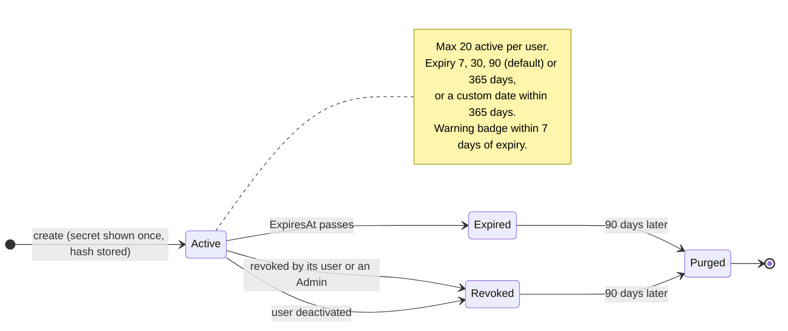

Revoked tokens stay revoked, also after the user is reactivated. Creating, listing and revoking tokens needs a browser session: no PAT can manage PATs.

Authenticating a request:

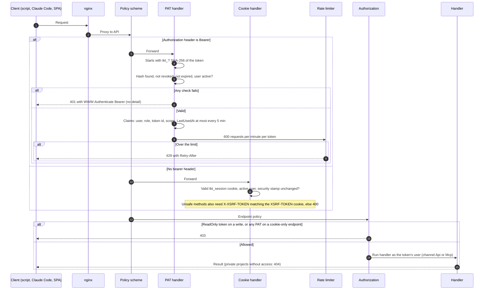

## 7. User onboarding

Spec: [§6.14](../product/01-refined-spec.md#614-user-and-authentication-lifecycle-d-01), [§4.1](../product/01-refined-spec.md#41-user), D-01, D-12, D-38, D-41.

On first start with an empty user table, the API creates the bootstrap Admin from `TICKETING_BOOTSTRAP_ADMIN_EMAIL` and `TICKETING_BOOTSTRAP_ADMIN_PASSWORD`, and refuses to start if they are missing. Every other account follows this flow:

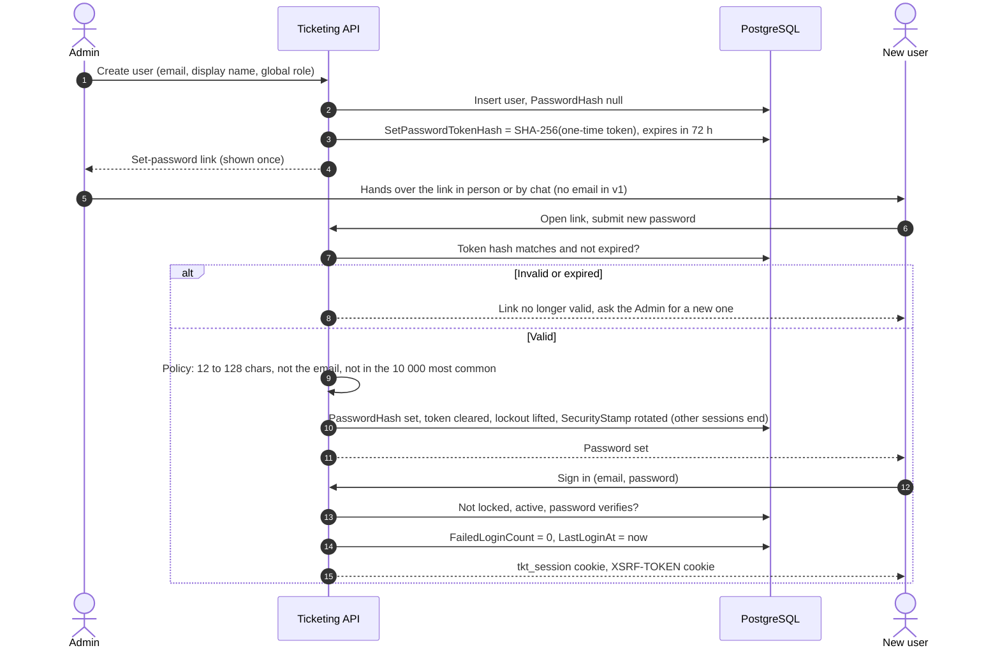

Account states:

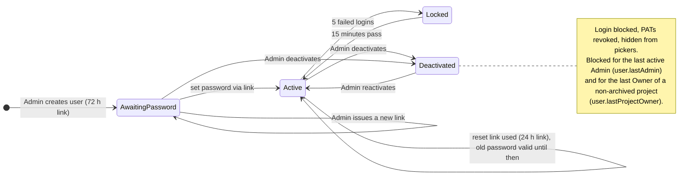

`AwaitingPassword` and `Locked` are not stored states: they follow from `PasswordHash` being null and from `LockedUntil` being in the future. A reactivated user who never set a password still needs a set-password link: deactivation clears a pending one.

Users change their own password with the current one. That rotates the security stamp: every other cookie session ends at its next request, and the current session is re-issued with the new stamp (D-55). Unknown, used, expired and deactivated users' links all give the same 404 (D-56).

## 8. Feature flag evaluation and view variants

Spec: [§6.13](../product/01-refined-spec.md#613-feature-flags-and-view-variants), [§4.15](../product/01-refined-spec.md#415-featureflag), D-14. Mechanics: [ADR 0007](../adr/0007-feature-flags.md), [ADR 0008](../adr/0008-ab-ready-views.md).

Evaluation for a signed-in user; the first match wins:

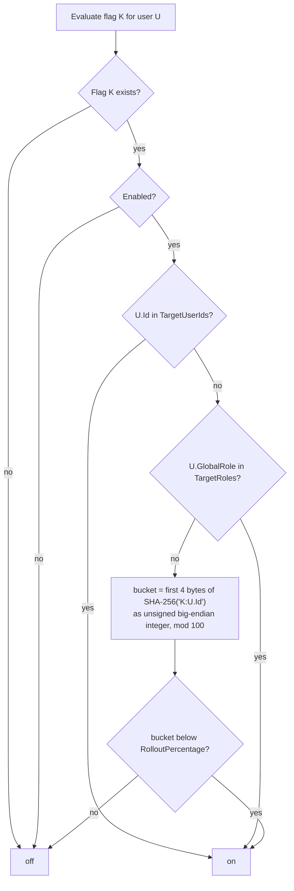

The bucket is stable across restarts and identical in C# and TypeScript; the user id is the lower-case hyphenated GUID string.

From flags to a rendered page:

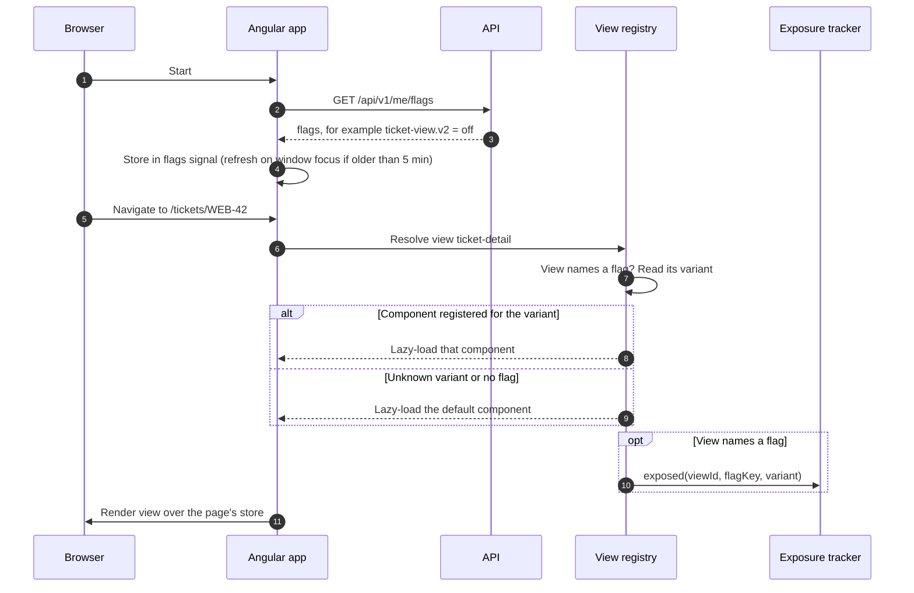

In v1 every view has only a `default` variant, so the registry always renders it; the flow above is the seam for later A/B tests.

## 9. MCP request flow

Spec: [§9](../product/01-refined-spec.md#9-mcp-server), D-36. Mechanics: [ADR 0004](../adr/0004-in-process-mcp-server.md).

Setup: the user creates a PAT in the web UI, copies the ready-made snippet, and runs `claude mcp add --transport http ticketing https://<host>/mcp --header "Authorization: Bearer tkt_..."`.

```mermaid
sequenceDiagram
    autonumber
    participant CC as Claude Code
    participant N as nginx
    participant AU as Auth (PAT only on /mcp)
    participant M as MCP endpoint (stateless)
    participant T as Tool class
    participant H as Application handler
    participant DB as PostgreSQL
    CC->>N: POST /mcp tools/list, Bearer tkt_...
    N->>AU: Proxy (no buffering, 300 s timeout)
    AU->>M: Authenticated as the token's user
    M-->>CC: Tools allowed by the token scope (ReadOnly hides write tools)
    CC->>N: POST /mcp tools/call update_ticket key WEB-42, status Review
    N->>AU: Proxy
    AU->>M: Authenticated, rate limit checked
    M->>T: Bind arguments, scope policy for write tools
    T->>H: UpdateTicket request (same handler as REST)
    H->>DB: Effective access, validation, domain rules, save
    H->>DB: ActivityEntry with channel Mcp
    alt Success
        H-->>T: Updated ticket
        T-->>CC: JSON result (ticket with rowVersion)
    else Application error
        H-->>T: Error code
        T-->>CC: isError true, code, message, hint
    end
```

- A browser cookie on `/mcp` gets `401`: MCP accepts PATs only.
- Every call is one HTTP request; there is no MCP session to keep.
- User administration, PAT management, feature flags, project deletion and board deletion are not exposed over MCP.

## 10. Attachment upload

Spec [§4.8](../product/01-refined-spec.md#48-attachment-i-07), D-63. The same flow serves the Attach button, drag and drop on the attachments section, and paste or drop into a markdown editor (which then inserts ``).

```mermaid
sequenceDiagram
    participant B as Browser
    participant A as API (UploadAttachment)
    participant DB as PostgreSQL
    B->>A: POST /tickets/WEB-42/attachments (multipart "file")
    A->>A: Write access to the ticket's project (404 unreadable, 403 viewer, 409 archived)
    A->>A: Size 1 B..10 MiB, allow-listed type, bytes match the type
    A->>DB: BEGIN; SELECT ticket FOR UPDATE; count attachments
    alt 50 already
        A-->>B: 409 attachment.limitReached
    else
        A->>DB: INSERT attachment + attachment_content, bump ticket UpdatedAt, activity attachment.added
        A-->>B: 201 attachment (url /api/v1/attachments/{id})
    end
```

- Delete: the uploader (with write access) or a project Owner. It removes the metadata and the content and records `attachment.removed`.
- Read: anyone who can read the ticket. Attachments of deleted tickets answer 404 like the ticket.
